<div align="center">

# 📡 BER Performance of BPSK, QPSK and 16-QAM
### over a Rayleigh Flat-Fading Channel

*Monte-Carlo simulation in MATLAB, verified against closed-form theory*


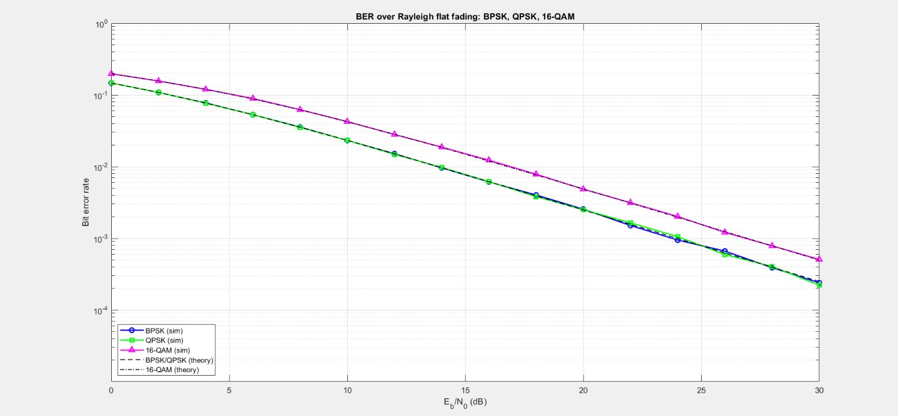

| | |
|---|---|
| **Course** | Digital Communications: Modulation, Project Part 2 |
| **University** | Cairo University, Faculty of Engineering, Electronics and Communications Dept., 3rd Year |
| **Tool** | MATLAB (single script, `main.m`, R2018b or newer) |
| **Authors** | Hesham Abd El-Rahman Mahmoud |

</div>

## 🧭 Contents

| | Section | | Section |
|---|---|---|---|
| 1 | [Overview](#1-overview) | 7 | [Constellation figures](#7-constellation-figures) |
| 2 | [Repository structure](#2-repository-structure) | 8 | [Simulation against theory](#8-simulation-against-theory) |
| 3 | [How to run](#3-how-to-run) | 9 | [Discussion](#9-discussion) |
| 4 | [System model](#4-system-model) | 10 | [Requirements checklist](#10-requirements-checklist) |
| 5 | [Assignment steps and code](#5-assignment-steps-and-where-they-are-in-the-code) | 11 | [Notes](#11-notes) |
| 6 | [Implementation with checkers](#6-implementation-part-by-part-with-checkers) | | |
---

## 1. Overview

This project simulates the **bit-error rate (BER)** of three modulation schemes, **BPSK, QPSK and 16-QAM**, transmitted over a **Rayleigh flat-fading channel** with additive white Gaussian noise (AWGN). The receiver knows the channel, so it removes the channel by **channel inversion** and then makes a **hard decision**.

For each scheme the simulation:

1. generates a random bit stream,
2. maps the bits to symbols (Gray mapping),
3. generates a complex Rayleigh channel and complex noise,
4. computes the received symbols `y = h·x + n`,
5. compensates for the channel (`y / h`) and applies hard decisions,
6. measures the BER at each Eb/N0 value from 0 to 30 dB,
7. plots the BER against SNR together with the theory.

The simulated curves are compared with closed-form theory, and every stage has a **checker** that proves the stage is correct before the next one is built on it.

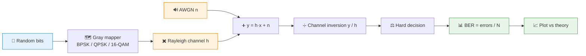

> [!NOTE]
> Every part of the code ends with a **checker**. A stage is only trusted after its checker passes, and the next stage is built on top of it.

### 🏆 Key results at a glance

| 📌 Result | Value |
|---|---|
| BPSK BER at 10 dB | about 0.023 (simulated 0.02288, theory 0.02327) |
| BPSK and QPSK BER at 30 dB | about 2.4e-4 |
| 16-QAM BER at 30 dB | about 5e-4 |
| BPSK versus QPSK | identical curves per bit |
| 16-QAM versus QPSK | about 3 dB worse at high SNR |
| Slope of all Rayleigh curves | about one decade of BER per 10 dB |

> [!IMPORTANT]
> The simulated curves sit on the theoretical Rayleigh curves for all three schemes over the whole 0 to 30 dB range.

---

## 2. Repository structure

```
rayleigh-ber-bpsk-qpsk-16qam/
├── 📄 README.md        <- this report
├── 🧮 main.m           <- the complete simulation (all parts + local functions)
└── 🖼️ images/
    ├── 01_channel_check.png
    ├── 02_ber_bpsk.png
    ├── 03_ber_qpsk.png
    ├── 04_ber_16qam.png
    ├── 05_ber_comparison.png
    ├── 06_constellation_bpsk.png
    ├── 07_constellation_qpsk.png
    ├── 08_constellation_16qam.png
    ├── 09_check_16qam_awgn.png
    └── 10_constellations_equalised.png
```

### 🗺️ Code map (important blocks in `main.m`)

| Block in `main.m` | Purpose |
|---|---|
| Part 0 | parameters: number of bits, SNR range, Eb, N0 |
| Part 1 | random bits and BPSK mapping |
| Part 2 | Rayleigh channel generation and its checks |
| Part 3 | complex noise generation and its checks |
| Part 4 | received signal and channel inversion |
| Part 5 | BPSK receiver at one SNR point |
| Part 6 | BPSK BER loop, theory and plot |
| Part 7 | QPSK: mapping, checks, BER loop |
| Part 8 | 16-QAM: mapping, checks, AWGN validation, BER loop, theory |
| Part 9 | final comparison plot |
| constellation plots | ideal, received and equalized constellations |
| Local functions | `plot_ber`, `map_*`, `demap_*`, `gen_channel`, `gen_noise`, `show_constellation` |

---

## 3. How to run

1. Open MATLAB and set the current folder to this repository.
2. Run `main.m`.
3. The Command Window prints all checker results. Eight figures open: the channel check, three BER plots (one per scheme), the final comparison, and three constellation figures (one per scheme).

> [!TIP]
> Notes before you run:
>
> - `rng(1)` fixes the random seed, so the results are repeatable.
> - `N = 1e6` bits per SNR point. The run takes a short while because every SNR point regenerates all the random data.
> - In MATLAB, all `function` definitions of a script must be at the end of the file, so they are at the end of `main.m`. This needs MATLAB R2016b or newer, and `sgtitle` needs R2018b or newer.

---

## 4. System model

The transmitter maps bits `b_k` to baseband symbols `x_k`. The carrier is

$$\phi(t)=\sqrt{\frac{2}{T_b}}\cos(2\pi f_c t)$$

The channel is flat Rayleigh fading:

$$h(t)=A_h e^{j\theta_h}\delta(t)=(h_r+jh_i)\,\delta(t)$$

- `h_r` and `h_i` are independent Gaussian variables with zero mean and variance **1/2**.
- Therefore the amplitude `A_h = |h|` is **Rayleigh** distributed, the phase `θ_h` is **uniform** on [0, 2π], and `E[|h|²] = 1`.

The noise is complex AWGN:

$$n=n_c+jn_s,\qquad n_c,\;n_s\sim\mathcal{N}\!\left(0,\tfrac{N_0}{2}\right)$$

so `E[|n|²] = N0`. The discrete-time received symbol is

$$y_k=(h_r+jh_i)_k\,x_k+(n_c+jn_s)_k$$

The channel is **known at the receiver**, so the receiver compensates for it:

$$\tilde{x}_k=\frac{y_k}{h_k}=x_k+\frac{n_k}{h_k}$$

and a hard decision is applied on `x̃_k`.

### ⚖️ Normalisation

`Eb = 1` and `N0 = Eb / (Eb/N0)`, so the x-axis of every plot is the **energy per bit** over the noise density. This makes the three schemes comparable.

| Scheme | Bits per symbol | Symbol energy | Amplitudes |
|---|---|---|---|
| BPSK | 1 | Es = Eb | ±√Eb |
| QPSK | 2 | Es = 2Eb | ±√Eb on I and Q |
| 16-QAM | 4 | Es = 4Eb | ±d, ±3d with d = √(0.4·Eb) |

> [!NOTE]
> For 16-QAM the average power with levels ±1, ±3 on each axis is 10, so `10·d² = 4·Eb`, which gives `d² = 0.4·Eb`.

---

## 5. Assignment steps and where they are in the code

| Step | Requirement | Where it is implemented |
|---|---|---|
| a | generate a random bit stream | `randi([0 1], 1, N)` in Part 1 and in every BER loop |
| b | generate the BPSK symbols | `map_bpsk` |
| c | generate the complex channel and noise vectors | `gen_channel`, `gen_noise` |
| d | compute the received symbols | `y = h .* x + n` |
| e | compensate for the channel, correlator, hard decision | `y ./ h`, then `demap_bpsk`, `demap_qpsk`, `demap_16qam` |
| f | compute the BER | `mean(b_hat ~= bits)` |
| g | change the noise level and repeat | the loops `for k = 1:numel(SNR_dB)` with `N0(k)` |
| h | plot the BER against SNR | `plot_ber` (one figure per scheme) and Part 9 (all schemes) |
| extra | repeat for QPSK and 16-QAM with the given constellations | Part 7, Part 8, `map_qpsk`, `map_16qam` |

> [!NOTE]
> **About the "correlator":** the simulation works on one complex sample per symbol. In the continuous-time system, multiplying by the carrier and integrating over `Tb` only scales the symbol, so the equalized sample `y/h` is the correlator output of the discrete-time equivalent model, and the threshold stays at 0.

---

## 6. Implementation, part by part (with checkers)

### Part 0: Setup

```matlab
N = 1e6;                         % number of bits per SNR point
assert(mod(N,4) == 0, 'N must be a multiple of 4 (needed for 16-QAM)');
SNR_dB  = 0:2:30;
SNR_lin = 10.^(SNR_dB/10);       % linear Eb/N0
Eb = 1;                          % normalized bit energy
N0 = Eb ./ SNR_lin;              % one N0 per SNR point
```

`N` must be a multiple of 4 because 16-QAM uses 4 bits per symbol. The SNR range goes up to 30 dB because Rayleigh BER falls slowly.

🔎 **Checker:** the table of `N0` against SNR.

<details>
<summary>📋 Show the full N0 table (16 SNR points)</summary>

| SNR_dB | SNR_lin | N0 |
|---|---|---|
| 0 | 1 | 1 |
| 2 | 1.5849 | 0.63096 |
| 4 | 2.5119 | 0.39811 |
| 6 | 3.9811 | 0.25119 |
| 8 | 6.3096 | 0.15849 |
| 10 | 10 | 0.1 |
| 12 | 15.849 | 0.063096 |
| 14 | 25.119 | 0.039811 |
| 16 | 39.811 | 0.025119 |
| 18 | 63.096 | 0.015849 |
| 20 | 100 | 0.01 |
| 22 | 158.49 | 0.0063096 |
| 24 | 251.19 | 0.0039811 |
| 26 | 398.11 | 0.0025119 |
| 28 | 630.96 | 0.0015849 |
| 30 | 1000 | 0.001 |

</details>

Result: `N0 = 1/SNR_lin` at every point (1 at 0 dB, 0.1 at 10 dB, 0.01 at 20 dB, 0.001 at 30 dB). ✅ **Pass.**

### Part 1: Bit generation and BPSK mapping

```matlab
bits = randi([0 1], 1, N);       % random bit stream (row vector)
x    = map_bpsk(bits, Eb);       % BPSK symbols

function x = map_bpsk(bits, Eb)
% 0 -> -sqrt(Eb), 1 -> +sqrt(Eb)
    x = sqrt(Eb) * (2*bits - 1);
end
```

🔎 **Checker:** the code prints the fraction of ones, the average symbol power, the unique symbol values, and the first 8 bits and symbols.

| Check | Expected |
|---|---|
| fraction of ones | about 0.5 |
| average symbol power | Eb = 1 |
| unique symbol values | -1 and +1 |
| first 8 bits and symbols | each 0 maps to -1, each 1 maps to +1 |

### Part 2: Channel generation

```matlab
h = gen_channel(N);

function h = gen_channel(N)
% hr, hi ~ N(0, 1/2)  ->  |h| is Rayleigh, phase is uniform, E[|h|^2] = 1
    hr = sqrt(1/2) * randn(1, N);
    hi = sqrt(1/2) * randn(1, N);
    h  = hr + 1j*hi;
end
```

One independent channel sample is generated per symbol (flat fading).

🔎 **Checker:** printed variances of `h_r` and `h_i` (expected 0.5) and the mean of `|h|²` (expected 1), plus two histograms.

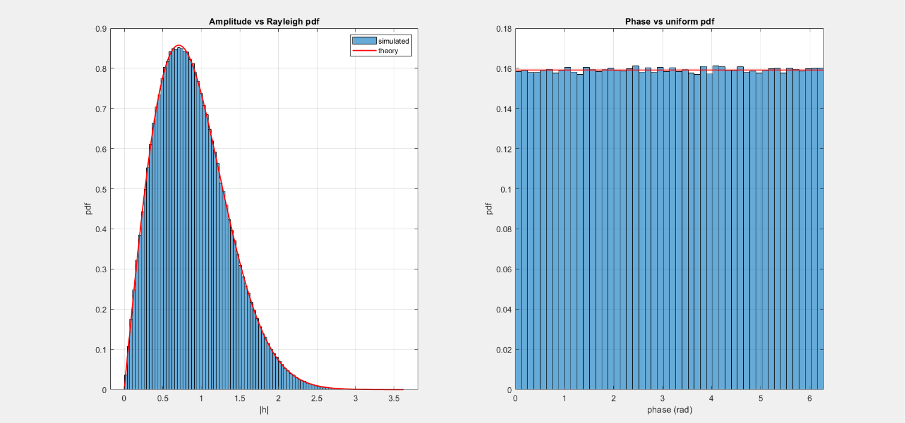

*Left:* the histogram of `|h|` lies on the theoretical Rayleigh pdf `2r·exp(-r²)`, with the peak near 0.7. *Right:* the phase histogram is flat around `1/(2π) ≈ 0.159`. ✅ **Pass.**

### Part 3: Noise generation

```matlab
function n = gen_noise(N, N0)
% nc, ns ~ N(0, N0/2) each  ->  total noise variance E[|n|^2] = N0
    nc = sqrt(N0/2) * randn(1, N);
    ns = sqrt(N0/2) * randn(1, N);
    n  = nc + 1j*ns;
end
```

🔎 **Checker:** variance and mean of the noise components at 0, 10, 20 and 30 dB.

| SNR_dB | N0/2 (expected) | var(nc) | var(ns) | mean(nc) | mean(ns) |
|---|---|---|---|---|---|
| 0 | 0.50000 | 0.50052 | 0.50029 | 0.00017 | 0.00089 |
| 10 | 0.05000 | 0.05005 | 0.05002 | 0.00012 | -0.00005 |
| 20 | 0.00500 | 0.00501 | 0.00499 | -0.00003 | -0.00009 |
| 30 | 0.00050 | 0.00050 | 0.00050 | 0.00002 | 0.00000 |

The variances match `N0/2` to about three digits and the means are near zero. ✅ **Pass.**

### Part 4: Received signal and channel inversion

```matlab
% (1) Noiseless check: y = h.*x, then dividing by h must give x back
y0    = h .* x;
x_eq0 = y0 ./ h;

% (2) With noise at 10 dB (index 6): y = h.*x + n
k = 6;
n = gen_noise(N, N0(k));
y = h .* x + n;
x_eq = y ./ h;                       % equalized symbols = x + n./h
```

🔎 **Checker:**

| Check | Expected | Observed |
|---|---|---|
| max `abs(x_eq - x)` with no noise | about 1e-16 | 8.841e-17 |
| mean `abs(y)²` at 10 dB | `Eb·E[abs(h)²] + N0 = 1.1000` | 1.1010 |
| mean `abs(x_eq - x)²` at 10 dB | much larger than `N0 = 0.1` | 1.2305 |

> [!WARNING]
> The large third value is expected, see the explanation below.

The first two lines confirm that inversion is exact without noise and that the received power is correct. The third value is large because the equalized noise is `n/h`, whose average power `N0·E[1/|h|²]` is theoretically unbounded for Rayleigh fading, so it is dominated by the few symbols in a deep fade. It varies from run to run. The BER only uses the sign, so it is not affected in the same way. This is the reason fading hurts so much.

### Part 5: BPSK receiver at one SNR point

```matlab
function b_hat = demap_bpsk(x_eq)
% Decision with threshold 0 on the real part
    b_hat = real(x_eq) > 0;
end

b_hat0 = demap_bpsk(y0 ./ h);        % no noise: errors must be 0
b_hat  = demap_bpsk(x_eq);           % with noise at 10 dB
ber10  = mean(b_hat ~= bits);
ber10_theory = 0.5 * (1 - sqrt(g/(1+g)));    % BPSK over Rayleigh
```

🔎 **Checker:**

| Check | Expected | Observed |
|---|---|---|
| errors with no noise | 0 | 0 |
| BER at 10 dB | close to theory | 0.02288 |
| theory at 10 dB | | 0.02327 |

The gap is about 2.6 standard deviations for 1e6 bits, so it is statistical noise and not a bug. The full BER curve in Part 6 confirms it. ✅ **Pass.**

### Part 6: BER loop for BPSK

```matlab
for k = 1:numel(SNR_dB)
    bits  = randi([0 1], 1, N);          % new bits
    x     = map_bpsk(bits, Eb);          % BPSK symbols
    h     = gen_channel(N);              % new channel (one sample per symbol)
    n     = gen_noise(N, N0(k));         % noise for this SNR
    y     = h .* x + n;                  % received signal
    b_hat = demap_bpsk(y ./ h);          % equalize + hard decision
    BER_bpsk(k) = mean(b_hat ~= bits);   % bit error rate
end

BER_bpsk_rayleigh = 0.5 * (1 - sqrt(SNR_lin ./ (1 + SNR_lin)));   % BPSK/QPSK, Rayleigh
BER_bpsk_awgn     = 0.5 * erfc(sqrt(SNR_lin));                    % BPSK, AWGN only
```

All random data is regenerated for every SNR point, which is steps a to f repeated for each noise level (step g).

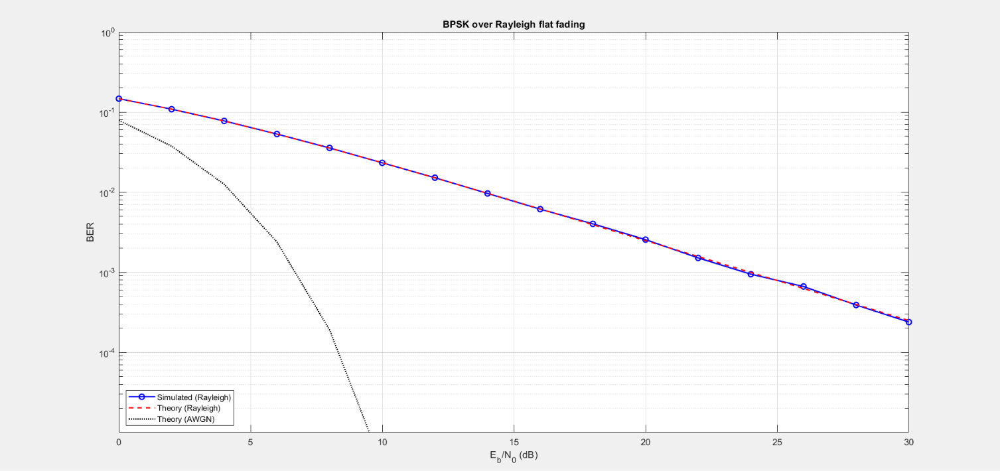

The simulated points (blue circles) lie on the theoretical Rayleigh curve (red dashed) over the whole range. The AWGN-only theory (black dotted) falls much faster, so the gap between the curves is the loss caused by fading. The Rayleigh curve falls by about one decade per 10 dB.

### Part 7: QPSK

Gray mapping from the assignment figure (`b0` controls I, `b1` controls Q):

| bits | symbol |
|---|---|
| 00 | (-1, -1) |
| 01 | (-1, +1) |
| 11 | (+1, +1) |
| 10 | (+1, -1) |

```matlab
function x = map_qpsk(bits, Eb)
% Gray QPSK: b0 -> I, b1 -> Q, (0 -> -1, 1 -> +1), scaled so Es = 2*Eb
    b0 = bits(1:2:end);
    b1 = bits(2:2:end);
    x  = sqrt(Eb) * ((2*b0 - 1) + 1j*(2*b1 - 1));
end

function bits_hat = demap_qpsk(x_eq)
% Threshold 0 on I and Q separately
    bits_hat = zeros(1, 2*numel(x_eq));
    bits_hat(1:2:end) = real(x_eq) > 0;     % b0
    bits_hat(2:2:end) = imag(x_eq) > 0;     % b1
end
```

A QPSK symbol carries 2 bits, so there are `N/2` symbols per SNR point and the BER is still errors divided by `N` bits.

🔎 **Checkers:**

| Check | Expected |
|---|---|
| mapping table printout | 00 to (-1,-1), 01 to (-1,+1), 11 to (+1,+1), 10 to (+1,-1) |
| average symbol power | 2·Eb = 2 |
| errors with no noise | 0 |

The labelled ideal constellation in the QPSK constellation figure (Section 7.3) confirms the mapping.

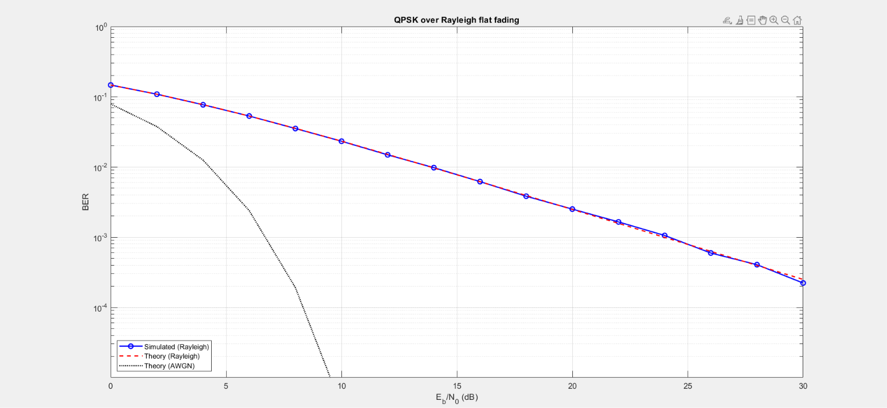

The QPSK curve coincides with the theoretical curve of BPSK, which is the expected result.

### Part 8: 16-QAM

From the assignment figure, `b0b1` select the I level and `b2b3` select the Q level, with Gray order `00 -> -3`, `01 -> -1`, `11 -> +1`, `10 -> +3` on both axes.

```matlab
function x = map_16qam(bits, Eb)
    d   = sqrt(0.4*Eb);
    lut = [-3 -1 3 1];                    % index = 2*first_bit + second_bit + 1
    b   = reshape(bits, 4, []);           % one column per symbol
    I   = lut(2*b(1,:) + b(2,:) + 1);
    Q   = lut(2*b(3,:) + b(4,:) + 1);
    x   = d * (I + 1j*Q);
end

function bits_hat = demap_16qam(x_eq, Eb)
% Thresholds at -2d, 0, +2d on each axis
    d   = sqrt(0.4*Eb);
    r_I = real(x_eq) / d;
    r_Q = imag(x_eq) / d;
    bits_hat = zeros(1, 4*numel(x_eq));
    bits_hat(1:4:end) = r_I > 0;              % first bit: sign of the level
    bits_hat(2:4:end) = abs(r_I) < 2;         % second bit: 1 for the inner levels
    bits_hat(3:4:end) = r_Q > 0;
    bits_hat(4:4:end) = abs(r_Q) < 2;
end
```

🔎 **Checkers:**

| Check | Expected |
|---|---|
| mapping printout (levels in units of d) | `0000` to (-3,-3), `0101` to (-1,-1), `1111` to (+1,+1), `1010` to (+3,+3), `0010` to (-3,+3), `1100` to (+1,-3) |
| average symbol power | 4·Eb = 4 |
| errors with no noise (fading) | 0 |
| AWGN-only BER against theory (h = 1) | simulated points on the theory curve |

**AWGN validation (check 3).** Before trusting the fading result, the mapper and demapper are tested with the channel removed (`h = 1`) over 0 to 12 dB, against the theory

$$P_b\approx\tfrac{3}{8}\,\mathrm{erfc}(a)+\tfrac{1}{4}\,\mathrm{erfc}(3a)-\tfrac{1}{8}\,\mathrm{erfc}(5a),\qquad a=\sqrt{0.4\,E_b/N_0}$$

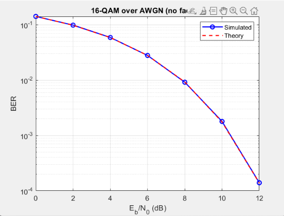

The simulated points lie on the theory curve at every SNR, which proves that the Gray mapping, the scaling `d = sqrt(0.4·Eb)` and the thresholds at `-2d, 0, +2d` are correct. (The code computes this check as `BER_awgn` and `BER_awgn_th`. The plotting lines were removed from the final script, and this figure is the one produced during development.)

**16-QAM over Rayleigh fading.** Each `erfc` term is averaged over the fading with

$$E\!\left[\mathrm{erfc}\!\left(\sqrt{g}\,|h|\right)\right]=1-\sqrt{\frac{g}{1+g}}$$

```matlab
g1 = 0.4*SNR_lin;  g3 = 9*g1;  g5 = 25*g1;
rf = @(g) 1 - sqrt(g ./ (1 + g));              % E[erfc(sqrt(g)*|h|)]
BER_16qam_th = 3/8*rf(g1) + 1/4*rf(g3) - 1/8*rf(g5);
```

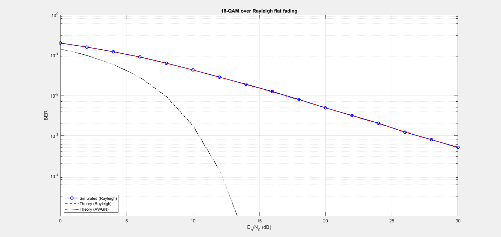

The simulation matches the theory over the whole range. At 20 dB the BER is about 5e-3 and at 30 dB about 5e-4.

### Part 9: Final comparison

```matlab
semilogy(SNR_dB, BER_bpsk,  'bo-', 'LineWidth', 1.5); hold on;
semilogy(SNR_dB, BER_qpsk,  'gs-', 'LineWidth', 1.5);
semilogy(SNR_dB, BER_16qam, 'm^-', 'LineWidth', 1.5);
semilogy(SNR_dB, BER_bpsk_rayleigh, 'k--', 'LineWidth', 1);       % BPSK/QPSK theory
semilogy(SNR_dB, BER_16qam_th,      'k-.', 'LineWidth', 1);       % 16-QAM theory
```


- BPSK and QPSK overlap each other and their common theory line.
- 16-QAM sits to the right. At high SNR it is about **3 dB** worse (for example, BPSK and QPSK reach 1e-3 near 24 dB, while 16-QAM reaches it near 27 dB).
- All three curves have the same slope, about one decade per 10 dB.

### Shared plotting function

Because the three BER figures must look identical, all of them are produced by one function:

```matlab
function plot_ber(snr_db, ber_sim, ber_rayleigh, ber_awgn, name)
    figure('Name', [name ' BER']);
    semilogy(snr_db, ber_sim,      'bo-', 'LineWidth', 1.5); hold on;
    semilogy(snr_db, ber_rayleigh, 'r--', 'LineWidth', 1.5);
    semilogy(snr_db, ber_awgn,     'k:',  'LineWidth', 1.5);
    grid on; xlabel('E_b/N_0 (dB)'); ylabel('BER'); ylim([1e-5 1]);
    title([name ' over Rayleigh flat fading']);
    legend('Simulated (Rayleigh)', 'Theory (Rayleigh)', 'Theory (AWGN)', 'Location', 'southwest');
end
```

The QPSK figure reuses the BPSK theory (both Rayleigh and AWGN), because QPSK has the same per-bit BER as BPSK. The 16-QAM figure uses its own Rayleigh theory and its own AWGN theory:

```matlab
BER_16qam_awgn = 3/8*erfc(sqrt(g1)) + 1/4*erfc(3*sqrt(g1)) - 1/8*erfc(5*sqrt(g1));
```

---

## 7. Constellation figures

The function `show_constellation` draws three panels for each scheme:

1. the **ideal** transmitted symbols with their **Gray bit labels**,
2. the **received** signal `y = h·x + n` before channel inversion,
3. the signal **after channel inversion** `y/h`, with the ideal points overlaid as red crosses.

### 🔭 At a glance (after channel inversion)

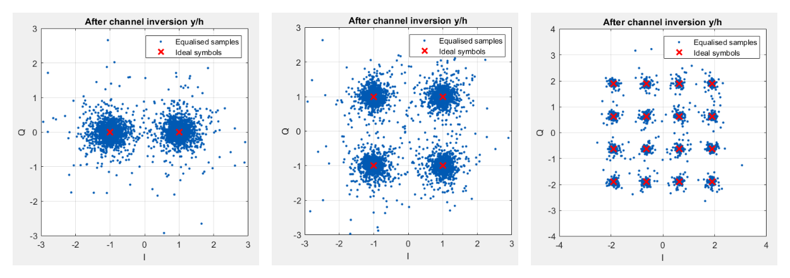

| BPSK, 15 dB | QPSK, 15 dB | 16-QAM, 25 dB |
|:---:|:---:|:---:|
| 2 clusters at ±1 | 4 clusters at (±1, ±1) | 16 clusters at ±d, ±3d |

The three full figures follow, each with the ideal Gray-labelled symbols, the raw received signal and the equalised signal.

### 7.1 BPSK at 15 dB

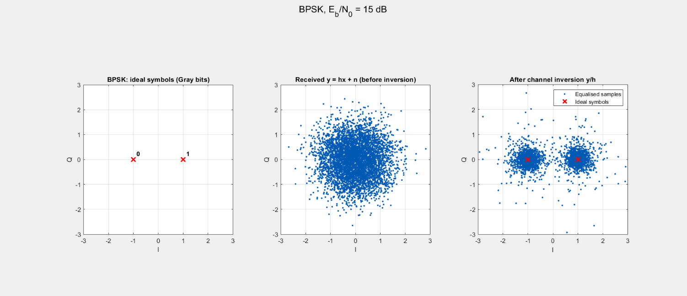

Two ideal points at ±1 labelled `0` and `1`. Before inversion, the points form a round cloud because every symbol is scaled by `|h|` and rotated by the phase of `h`. After inversion, two clusters appear around ±1, with a few outliers.

### 7.2 QPSK at 15 dB

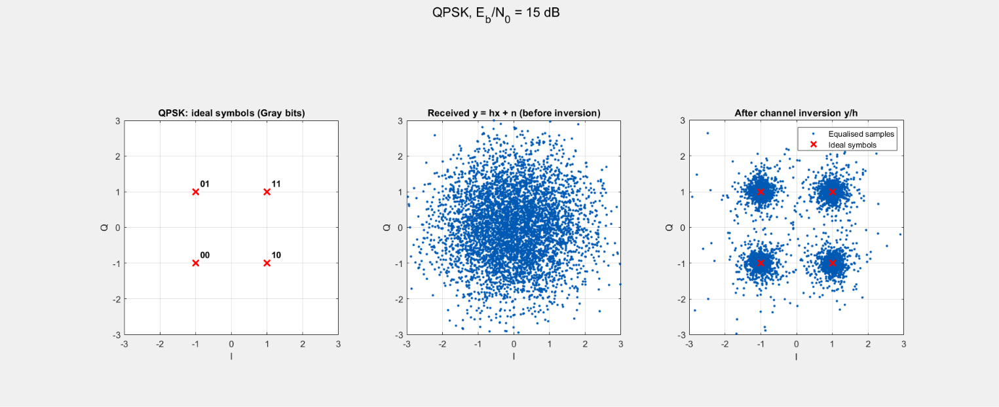

Four ideal points labelled `00`, `01`, `11`, `10`, which matches the Gray mapping of the assignment. After inversion, four clusters appear around (±1, ±1).

### 7.3 16-QAM at 25 dB

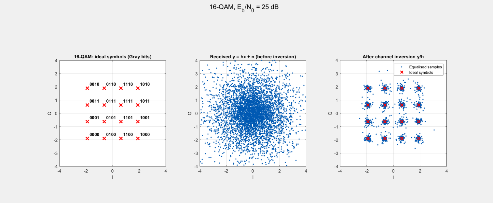

The 16 ideal points sit at ±0.63 and ±1.9 (that is ±d and ±3d with `d = sqrt(0.4)`), with Gray labels from `0000` (bottom-left) to `1010` (top-right). Neighbouring points differ in exactly one bit. 16-QAM is shown at 25 dB because at 15 dB the clusters overlap heavily.

> [!NOTE]
> **Why the clusters have outliers:** the equalized noise is `n/h`. When `|h|` is small (a deep fade), the noise is amplified, and the symbol can land on the wrong side of a decision threshold. These are the bit errors, and they are what keeps the Rayleigh BER high.

---

## 8. Simulation against theory

| Scheme | Rayleigh theory | AWGN theory |
|---|---|---|
| BPSK and QPSK (per bit) | `0.5·(1 - sqrt(γ/(1+γ)))` | `0.5·erfc(sqrt(γ))` |
| 16-QAM | `3/8·rf(0.4γ) + 1/4·rf(3.6γ) - 1/8·rf(10γ)` | `3/8·erfc(sqrt(0.4γ)) + 1/4·erfc(3·sqrt(0.4γ)) - 1/8·erfc(5·sqrt(0.4γ))` |

with `γ = Eb/N0` (linear) and `rf(g) = 1 - sqrt(g/(1+g))`.

At high SNR, `rf(g)` tends to `1/(2g)`, which gives

- BPSK and QPSK: `Pb ≈ 1/(4γ)` (2.5e-4 at 30 dB),
- 16-QAM: `Pb ≈ 1/(2γ)` (5e-4 at 30 dB).

So 16-QAM is twice the BER of QPSK, which is a gap of 3 dB. This matches the simulation.

---

## 9. Discussion

<details>
<summary><b>Why are the Rayleigh curves so shallow compared with AWGN?</b></summary>

Under AWGN the BER falls exponentially with SNR. Under Rayleigh fading, the BER is the AWGN BER averaged over the random channel gain. Most errors happen during deep fades, when `|h|` is small, and the probability of a deep fade only decreases as `1/SNR`. The result is a BER that falls by about one decade per 10 dB.

</details>

<details>
<summary><b>Why does QPSK equal BPSK per bit?</b></summary>

QPSK is two independent BPSK streams on the I and Q axes. Each bit has energy Eb and sees the same fading and noise, and Gray mapping makes one symbol error cost one bit error. So the curves overlap when plotted against Eb/N0.

</details>

<details>
<summary><b>Why is 16-QAM worse?</b></summary>

It sends 4 bits per symbol with the same energy per bit, so the minimum distance between points is smaller (`2d = 2·sqrt(0.4·Eb)` against `2·sqrt(Eb)` for QPSK). It needs about 3 dB more Eb/N0 at high SNR for the same BER, and in return it carries twice as many bits per symbol as QPSK.

</details>

<details>
<summary><b>Why divide by `h`?</b></summary>

The receiver knows the channel, so dividing by `h` removes the amplitude scaling and phase rotation. The price is noise enhancement when `|h|` is small.

</details>

<details>
<summary><b>Why must `N` be a multiple of 4?</b></summary>

16-QAM maps 4 bits to one symbol.

</details>

<details>
<summary><b>Why is the 16-QAM AWGN test needed?</b></summary>

It validates the mapper, the scaling and the decision thresholds independently of fading. Since the fading simulation then matches its own theory as well, the whole chain is verified.

</details>

---

## 10. Requirements checklist

- [x] Random bit stream generation (step a)
- [x] BPSK symbol mapping (step b)
- [x] Complex Rayleigh channel and complex noise with the stated distributions (step c)
- [x] Received symbol computation (step d)
- [x] Channel compensation (channel known at the receiver) and hard decision (step e)
- [x] BER computation (step f)
- [x] Repeat for different noise levels (step g)
- [x] BER against SNR plot for BPSK (step h)
- [x] QPSK and 16-QAM with the Gray constellations of the assignment
- [x] BER against SNR plot for QPSK and for 16-QAM
- [x] Comparison of all three schemes
- [x] Checkers for every stage
- [x] Code organised into commented parts and reusable functions

---

## 11. Notes

- The BER at the highest SNR points is based on a few hundred errors (for example about 240 errors out of 1e6 bits at 30 dB for BPSK), so the last points wiggle slightly around the theory. Raising `N` smooths them.
- The code has no toolbox dependency. It only uses base MATLAB functions (`randn`, `randi`, `erfc`, `histogram`, `semilogy`, and so on).
- Since the group submission is graded by discussion with the TA, every part of the code is commented so that it can be explained line by line.

---

<div align="center">

**Digital Communications, Project Part 2** · Cairo University, Faculty of Engineering · 2026

*Simulation, checkers, figures and theory all come from the single script `main.m`.*

[⬆ Back to top](#-ber-performance-of-bpsk-qpsk-and-16-qam)

</div>
